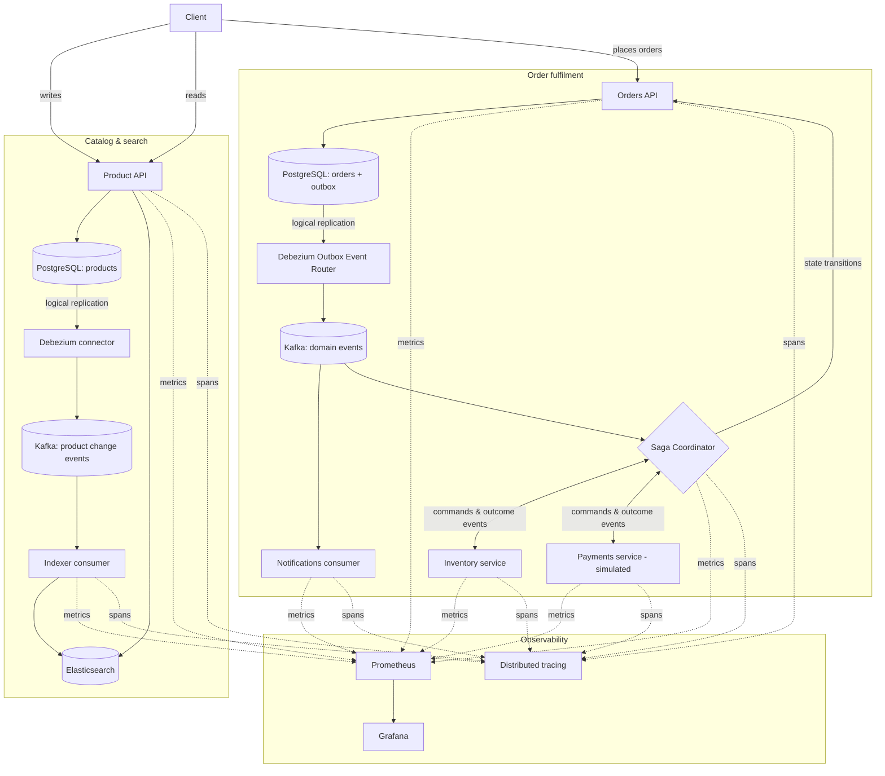

# Architecture

SearchSync is a product catalog and order-fulfilment system built to demonstrate a set of
distributed-systems patterns end to end, in Go, against real infrastructure: change-data-capture
driven search, the transactional outbox pattern, an orchestrated saga across independent
services, consumer reliability (retries/DLQ/replay), and operational observability.

PostgreSQL is the only system of truth. Every other store (Elasticsearch, the various Kafka
topics) is a derived, eventually-consistent view, rebuilt from PostgreSQL and Kafka rather than
written to directly by application code. No request path ever writes to two systems at once
without going through a single PostgreSQL transaction first.

## System diagram

## Core patterns

**Change data capture, not dual writes.** The product catalog's search index is never written
to by the API. Debezium reads PostgreSQL's write-ahead log and publishes every committed row
change to Kafka; a dedicated consumer applies those changes to Elasticsearch. A direct SQL edit
to the `products` table is just as visible to search as one made through the API, because both
paths go through the same WAL.

**Transactional outbox for business events.** Raw row-change events answer "what changed in this
table." Order fulfilment needs a stronger guarantee: "this specific business fact happened, and
it will be published." Writing to the `orders` table and an `outbox_events` table happens in one
PostgreSQL transaction, so the event can never be lost to a crash between "save the order" and
"publish the event," and it can never be published without a corresponding committed order.
A second Debezium connector, configured with the Outbox Event Router transform, turns outbox
rows into typed domain events on Kafka.

**Orchestrated saga, not a distributed transaction.** Completing an order touches three
independently-owned services: Orders, Inventory, and a simulated Payments service. None of them
share a database transaction. A Saga Coordinator owns the workflow: it is the only service that
reads every saga-relevant event, the only one that decides what happens next, and the only one
that issues commands. Inventory and Payments never call each other directly. Failure part-way
through (a declined payment, a payment that never responds, a release that itself fails)
triggers compensation - releasing reserved stock - which is itself retried with a bounded budget
and escalated to a human-visible state if it can't complete automatically.

**Consumer reliability as a shared concern, not a per-service afterthought.** Every consumer in
the system runs on one shared retry/dead-letter engine. A transient failure (a dependency being
briefly unavailable) is retried with backoff; a permanent failure (malformed input, a contract
violation) is quarantined to a dead-letter topic instead of blocking the partition forever. Every
service deduplicates incoming messages by a stable message ID, so at-least-once delivery from
Kafka never produces duplicate side effects. A standalone replay tool can reprocess a bounded
range of a topic through the exact same handler code the live consumer uses.

**Idempotency and identity throughout.** Every command and event carries a message ID, a
correlation ID that stays constant across one saga, and a causation ID chaining it back to the
message that triggered it. Combined with unique constraints at each write boundary (one
reservation per order, one authorization attempt per order), this is what makes retried commands,
redelivered events, and out-of-order delivery safe to handle, structurally, rather than by
inferring intent from application logic.

**Observability built in, not bolted on.** Every service exposes Prometheus metrics (processing
throughput, retry counts, consumer lag, dead-letter backlog, replication-slot retention) and
participates in distributed tracing. A trace started at an HTTP request is carried through the
outbox row, through the Debezium-published Kafka message headers, and resumed by the consumer
that eventually processes it - so one trace can span a request that crosses process, database,
and message-broker boundaries.

## Data ownership

Each service owns its own PostgreSQL schema and only ever accesses its own tables directly.
Cross-service coordination happens exclusively through Kafka. A narrowly-scoped replication role
has read-only access to each schema's outbox table, and nothing else - the same boundary the
application code itself respects.

## Infrastructure

PostgreSQL (logical replication enabled), Kafka, Kafka Connect running the Debezium connectors,
and Elasticsearch form the data-plane infrastructure. Prometheus, Grafana, and a tracing backend
form the observability plane. All of it runs locally via Docker Compose; application services
run as independent Go binaries alongside it.
